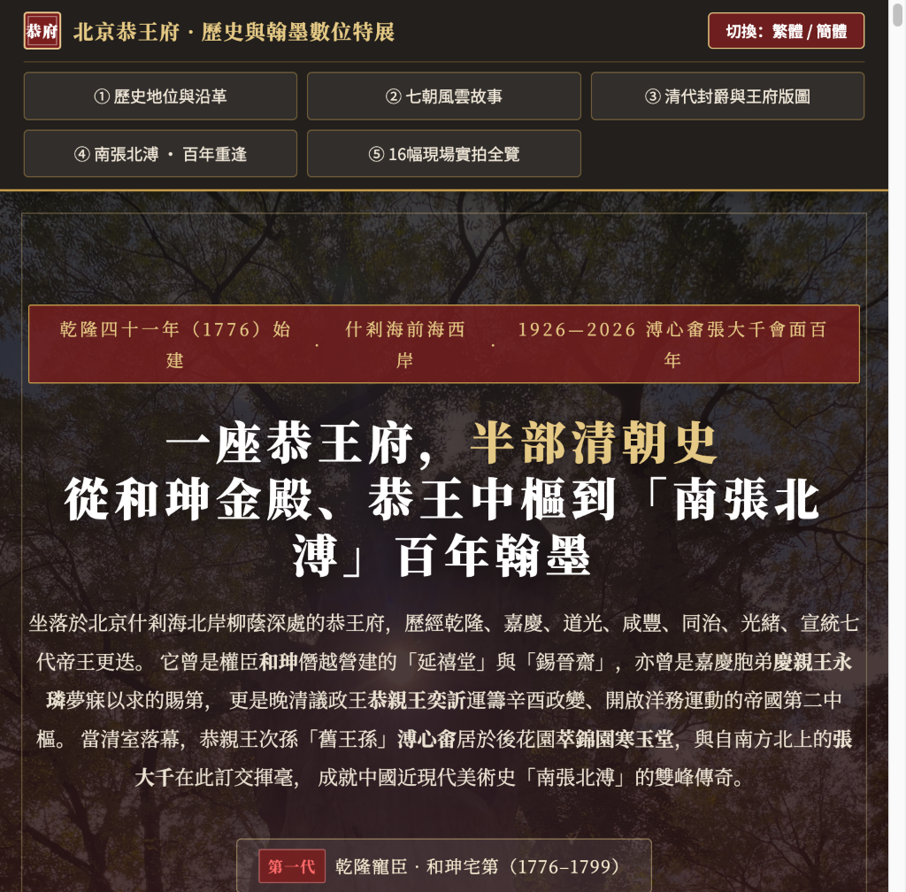
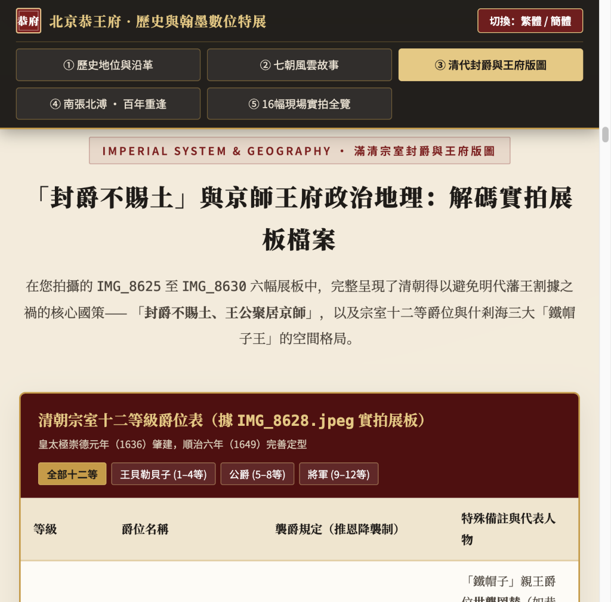

# 一座恭王府，半部清朝史｜北京恭王府歷史沿革與「南張北溥」百年交會數位特展

🌐 **線上瀏覽網址（GitHub Pages）**：[https://agneschaorl-stack.github.io/prince-gong-mansion/](https://agneschaorl-stack.github.io/prince-gong-mansion/)

## 專案簡介

本專題網頁依據北京恭王府現場實拍的 **16 幅高清影像**（所有上傳副本已無損移除 EXIF GPS 定位資訊並保留 Display P3 原色），結合文博史料與碑刻展板全文錄文，完整呈現「一座恭王府，半部清朝史」的七朝風雲與近現代畫壇「南張北溥」的百年情誼。

### 五大核心單元

1. **① 歷史地位與沿革**：解析恭王府橫跨乾隆至宣統七代帝王、從權臣豪宅到晚清「第二朝廷」的四大歷史支柱。
2. **② 七朝風雲故事（六大時期互動時間軸）**：
   - 和珅延禧堂／金絲楠木「錫晉齋」僭越奇案與嘉慶四年抄家（1776–1799）
   - 慶僖親王永璘的「慶王府」與推恩降襲收府（1799–1850）
   - 議政王恭親王奕訢、1860 洋務起點、1861 辛酉政變與「萬福萃錦園」（1850–1898）
   - 末代恭親王溥偉山中商會流失案與舊王孫溥心畬「寒玉堂」雅集（1898–1937）
   - 天主教輔仁大學女生部與《紅樓夢》大觀園考證（1937–1952）
   - 周恩來總理臨終遺願、全面開放與 2026 樂道堂百年特展（1962–2026）
3. **③ 清代封爵與王府版圖**：內建「清朝宗室十二等級爵位」互動篩選表、什剎海三大「鐵帽子王」地理版圖，以及鎮國公載澤夫人接待美國公使康格夫人的晚清外交故事。
4. **④ 南張北溥 · 百年重逢（1926–2026 樂道堂特展）**：梳理張大千與溥心畬在恭王府萃錦園寒玉堂的訂交故事、《放紙鳶》合作逸事、王孫老饕菜單，並高清展示故宮博物院藏張大千 1948 年名作《連理雙鴿》立軸真跡。
5. **⑤ 16 幅現場實拍全覽**：全部照片均經過自動去邊框、傾斜校正擺正與清晰度強化，附四大主題篩選、原碑展板全文錄文與全螢幕放大／旋轉燈箱。

